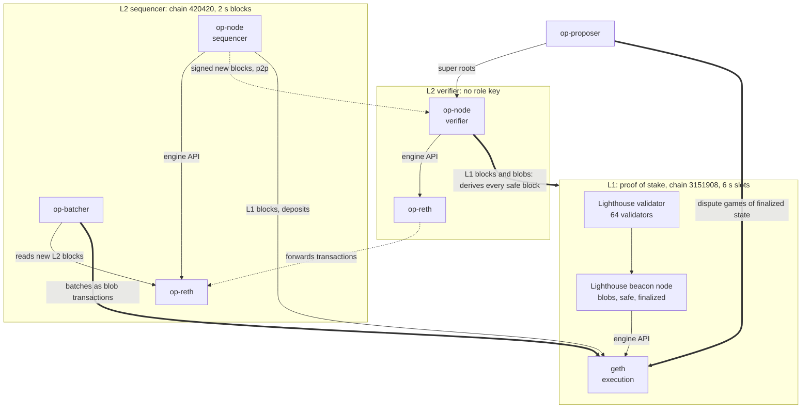

# settled

A self-run OP Stack L2 with a bridge that moves money safely, operated the way a
production network is operated.

The project has two parts. The first runs the chain: a local L1 and an OP Stack L2
that are deployed, monitored, upgraded and broken on purpose, with a runbook and a
post-mortem for every failure. The second moves money across it: a Go service that
indexes both chains and records every movement in a double-entry ledger. Deposits are
credited only at finality, reorgs are undone by reversing entries, and each withdrawal
is paid once.

Everything runs on one machine and needs no cloud account.

## Status

Stages 1 to 4 are done. A local proof-of-stake L1 runs, the L2 contracts are deployed
on it, the L2 sequencer produces blocks and the batcher posts them to the L1 as blobs,
so the L2 safe head follows the L1. A verifier node derives the same chain from the L1
and receives new blocks from the sequencer over peer-to-peer. The proposer posts the L2
state to the L1, every proposal is recomputed independently, and ETH moves both ways
with every wei accounted for. A dashboard answers whether the chain is healthy, every red
line is an alert with a runbook, a drill shows an alert fire and clear, and a load test
measures how many transfers a second the chain takes and how long until they are safe.
On the L2 a vault holds an exchange's funds: each withdrawal id is paid once, payments
at once stay within a rate limit, large ones wait in a queue the guardian can stop, and
every change of its rules waits in a timelock where a separate key can cancel it. Unit,
fuzz, invariant and symbolic tests check its invariants, and a written review lists
every finding.
This file describes only what exists and grows with the code.

The rules the code follows are in [ENGINEERING.md](ENGINEERING.md). The plan is in
[ROADMAP.md](ROADMAP.md).

## Quick start

```sh
make up
make status
make down
```

`make up` starts everything from any state: a fresh clone, a stopped devnet or a
running one. In order it starts and checks the L1, creates and funds the operator keys,
deploys the L2 contracts once, checks them, starts the L2 and checks it, including the
verifier. Each step is idempotent and stops the run on the first failure. Requires
Docker, curl, jq, bc, openssl and Go.

`make status` shows the services, the heads of both layers and the operator balances
without waiting. `make down` stops the L2 and then the L1 and keeps all data.
`make reset` deletes the chain data of both layers and the deployment; the role keys
are kept, and the next `make up` builds a new devnet with the same operator
addresses. The deployment records the L1 it was made on, and the L2 refuses to start
on any other L1.

The sections below are the parts `make up` runs, for working on one of them.

## Architecture



The sequencer builds a block every 2 s and gossips it, signed, to the verifier. The
batcher posts the new blocks to the L1 as blob transactions. Each op-node reads those
batches back from the L1, so a block moves through three states:

| State | Meaning | Comes from |
|---|---|---|
| unsafe | Built by the sequencer; the verifier has it from gossip | The sequencer alone |
| safe | Derived from a batch on the L1 | The L1; every node derives the same block |
| finalized | Its batch is in a finalized L1 block | L1 finality, two to three epochs (about 7 to 10 minutes here) |

Whenever the finalized L2 head has moved, at most once a minute, the proposer takes that
state from the verifier and posts it to the L1 as a dispute game. Withdrawals are proven against those games.

Security boundaries:

| What | Where it is reachable |
|---|---|
| JSON-RPC of geth, the beacon API, both op-reths and both op-nodes | `127.0.0.1` only |
| Engine APIs, peer-to-peer between the op-nodes | Inside Docker networks only |
| Sequencer key | The sequencer op-node only, as a secret file |
| Batcher key | op-batcher only, as a secret file |
| Proposer key | op-proposer only, as a secret file |
| Deployer key | op-deployer only, through the container environment, while `make l2-deploy` runs |
| Admin, guardian, challenger and fee recipient keys | No service uses them; with game type 5 the guardian, not a challenger, removes a wrong game |

## Local L1

```sh
make l1-up
make l1-check
make l1-blob-check
```

A proof-of-stake L1 with geth and Lighthouse, started from its own genesis. Requires
Docker, curl, jq and Go. Services, endpoints and files are described in
[infra/devnet/l1/README.md](infra/devnet/l1/README.md); the reasons behind the setup are
in [docs/design/devnet.md](docs/design/devnet.md).

## L2 operator keys and contracts

```sh
make l2-keys
make l2-fund
make l2-deploy
make l2-verify
```

One key per operator role, kept in `.devnet/l2/keys` and readable only by its owner.
`l2-fund` tops up the accounts that pay gas on the L1. `l2-deploy` deploys the L2
contracts with op-deployer and exports the L2 genesis and rollup config. `l2-verify`
reads the contracts on the L1 and the exported chain config, and checks every owner,
operator and parameter against the intent. The roles, the
key rules and the deployment choices are in
[docs/design/devnet.md](docs/design/devnet.md#l2-operator-roles-and-keys).

## Local L2

```sh
make l2-up
make l2-check
```

The L2 built from the deployment above: op-reth and op-node sequence blocks,
op-batcher posts them to the L1 as blobs, and a second op-reth and op-node verify them
from the L1. Services, endpoints and files are in
[infra/devnet/l2/README.md](infra/devnet/l2/README.md).

## Proposals and moving ETH

```sh
make l2-games
make l2-deposit
make l2-withdraw
```

`l2-games` checks the dispute games the proposer posts: each root claim is recomputed
from the verifier's execution client. `l2-deposit` moves 1 ETH from the L1 to the L2 and
`l2-withdraw` moves 0.1 ETH back, proven against a game and finalized on the L1; both
account for every wei on both sides, and a withdrawal cannot be paid twice. Why they work this way is in
[docs/design/devnet.md](docs/design/devnet.md#l2-proposer).

## Observability

```sh
make obs-check
```

Grafana at `http://127.0.0.1:3000` opens on six questions, each green or red: the L2
makes blocks, batches reach the L1, the verifier keeps up, proposals are made, the L1
finalizes, operators have funds; and four on the vault: it holds what it owes, its queue
is empty, it is open, it is watched. The details sit below, closed until needed. Each red
line is an alert rule in Prometheus (`http://127.0.0.1:9090`), sent to Alertmanager
(`http://127.0.0.1:9093`), with a runbook in [docs/runbooks.md](docs/runbooks.md).

```sh
make alert-drill
```

stops the batcher, shows its alert fire and reach Alertmanager, starts the batcher and
shows the alert clear.

```sh
make l2-load
```

sends 50 transfers a second to the L2 for two minutes and reports how many were
included, how fast, and how long until they were safe. Why it works this way is in
[docs/design/load.md](docs/design/load.md). What is collected and why is in
[docs/design/observability.md](docs/design/observability.md); the stack is in
[infra/observability/README.md](infra/observability/README.md).

## Checks

```sh
make check
```

Requires gitleaks, shellcheck and Go. CI runs the same command on every push to `main`
and every pull request, with the same tool versions. What each check does is in
[ENGINEERING.md](ENGINEERING.md#local-checks).

## License

MIT. See [LICENSE](LICENSE).
